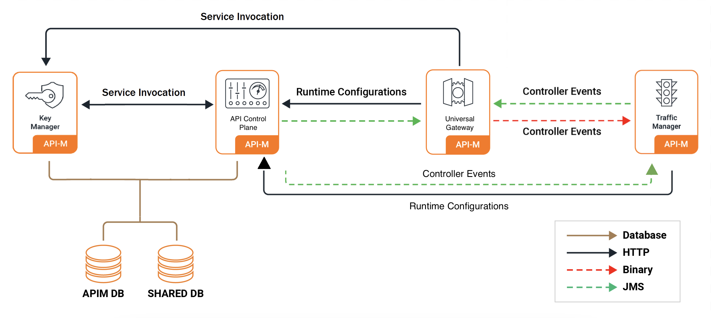

# Pattern 4: API-M Deployment with Fully Distributed Setup

This is the fully distributed deployment for API Manager. The default configuration consists of two API Control Planes, two Traffic Managers, two Classic Gateways (Universal), and two Key Managers. This is the most scalable and production-ready deployment pattern.

<a href="../../../../assets/img/setup-and-install/distributed-deployment-km.png"></a>

!!! info
    For advanced details on the deployment pattern, please refer to the official [documentation](kubernetes-overview.md).

## Contents

- [Pattern 4: API-M Deployment with Fully Distributed Setup](#pattern-4-api-m-deployment-with-fully-distributed-setup)
  - [Contents](#contents)
  - [Prerequisites](#prerequisites)
    - [Step 1 - Set Up Basic Configurations](#step-1---set-up-basic-configurations)
    - [Step 2 - Build Docker Images](#step-2---build-docker-images)
    - [Step 3 - Configure Database](#step-3---configure-database)
  - [Minimal Configuration](#minimal-configuration)
  - [Configuration](#configuration)
    - [1. General Configuration of Helm Charts](#1-general-configuration-of-helm-charts)
          - [1.1 Add Gateway API controller or Ingress controller](#11-add-gateway-api-controller-or-ingress-controller)
          - [1.2 Mount Keystore and Truststore](#12-mount-keystore-and-truststore)
          - [1.3 Configure Internal Encryption Key (Mandatory)](#13-configure-internal-encryption-key-mandatory)
          - [1.4 Encrypting Secrets (Cipher Tool and Secure Vault)](#14-encrypting-secrets-cipher-tool-and-secure-vault)
          - [1.5 Configure Docker Image and Databases](#15-configure-docker-image-and-databases)
          - [1.6 Configure SSL in Service Exposure](#16-configure-ssl-in-service-exposure)
    - [2. API Control Plane Configurations](#2-api-control-plane-configurations)
          - [2.1 Configure Multiple Gateways](#21-configure-multiple-gateways)
          - [2.2 Configure User Store Properties](#22-configure-user-store-properties)
          - [2.3 Configure JWKS URL](#23-configure-jwks-url)
          - [2.4 Deploy Control Plane](#24-deploy-control-plane)
    - [3. Traffic Manager Configurations](#3-traffic-manager-configurations)
          - [3.1 Configure Key Manager and Eventhub](#31-configure-key-manager-and-eventhub)
          - [3.2 Deploy Traffic Manager](#32-deploy-traffic-manager)
    - [4. Classic Gateway Configuration](#4-universal-gateway-configuration)
          - [4.1 Configure Key Manager, Eventhub and Throttling](#41-configure-key-manager-eventhub-and-throttling)
          - [4.2 Enable Replicas](#42-enable-replicas)
          - [4.3 Deploy Classic Gateway](#43-deploy-universal-gateway)
    - [5. Key Manager Configuration](#5-key-manager-configuration)
          - [5.1 Configure Eventhub](#51-configure-eventhub)
          - [5.2 Deploy Key Manager](#52-deploy-key-manager)
    - [6. Add a DNS Record Mapping the Hostnames and the External IP](#6-add-a-dns-record-mapping-the-hostnames-and-the-external-ip)
    - [7. Access Management Consoles](#7-access-management-consoles)

## Prerequisites

Before you begin, ensure you have the following prerequisites in place:

## Step 1 - Set Up Basic Configurations

!!! info
    The following tools and configurations are necessary for deploying WSO2 API-M in a Kubernetes environment.

1. Install the required tools:
   - [Git](https://git-scm.com/book/en/v2/Getting-Started-Installing-Git)
   - [Helm](https://helm.sh/docs/intro/install/)
   - [Kubernetes client](https://kubernetes.io/docs/tasks/tools/install-kubectl/)

2. Ensure you have a running [Kubernetes cluster](https://kubernetes.io/docs/setup/).

3. Install a routing controller. Choose either:

  - **[Envoy Gateway](https://gateway.envoyproxy.io/docs/install/install-helm/)** (enabled by default) - **RECOMMENDED** (modern Gateway API-based routing)
  - **[NGINX Ingress Controller](https://kubernetes.github.io/ingress-nginx/deploy/)** (disabled by default) - **DEPRECATED** (traditional Ingress-based routing)

4. Add the WSO2 Helm chart repository:
   ```bash
   helm repo add wso2 https://helm.wso2.com && helm repo update
   ```

## Step 2 - Build Docker Images

- WSO2 product Docker images are used for the Kubernetes deployment.
  
  WSO2 product Docker images available at [DockerHub](https://hub.docker.com/u/wso2/) package General Availability (GA) versions of WSO2 products with no [WSO2 Updates](https://wso2.com/updates).

  For a production-grade deployment of the desired WSO2 product version, it is highly recommended to use the relevant Docker image which packages WSO2 Updates, available at the [WSO2 Private Docker Registry](https://registry.wso2.com/). To use these images, you need an active [WSO2 Subscription](https://wso2.com/subscription).

- WSO2 API Manager 4.7.0 provides three Docker images:
  - API Control Plane - [wso2am-acp](https://hub.docker.com/r/wso2/wso2am-acp)
  - Traffic Manager - [wso2am-tm](https://hub.docker.com/r/wso2/wso2am-tm)
  - Classic Gateway (Universal) - [wso2am-universal-gw](https://hub.docker.com/r/wso2/wso2am-universal-gw)

  !!! note
      There is no separate Docker image for the Key Manager. The API Control Plane image should be used for the Key Manager component.

- Since the products need to connect to databases at runtime, you need to include the relevant JDBC drivers in the distribution. This can be included in the Docker image building stage. For example, you can add the MySQL driver as follows:
  ```dockerfile
  ADD --chown=wso2carbon:wso2 https://repo1.maven.org/maven2/mysql/mysql-connector-java/8.0.28/mysql-connector-java-8.0.28.jar ${WSO2_SERVER_HOME}/repository/components/lib
  ```
- Furthermore, if there are any customizations to the JARs in the product, those can be included in the Docker image itself rather than mounting them from the deployment level (assuming that they are common to all environments).
- The following is a sample Dockerfile to build a custom WSO2 APIM image. Depending on your requirements, you may refer to the following and make the necessary additions. The script below will do the following:
  - Use WSO2 APIM 4.7.0 as the base image
  - Copy third-party libraries to the `<APIM_HOME>/lib` directory

  - Dockerfile for API Control Plane
    ```dockerfile
    FROM registry.wso2.com/wso2-apim/am-acp:4.7.0.0

### Step 1 — Install Required Tools

1. Ensure the following tools are installed on your machine:

    | Tool | Purpose | Install Guide |
    | ---- | ------- | ------------- |
    | `kubectl` | Kubernetes CLI for managing cluster resources | [Install](https://kubernetes.io/docs/tasks/tools/) |
    | `helm` (v3) | Package manager for deploying WSO2 Helm charts | [Install](https://helm.sh/docs/intro/install/) |
    | `docker` | Required to build and push custom WSO2 images | [Install](https://docs.docker.com/get-docker/) |

2. Verify all tools are installed and check their versions:

    ```bash
    kubectl version --client
    helm version
    docker info
    ```

    !!! note "Version Compatibility"
        Ensure your tool versions are within the supported ranges listed in the [Prerequisites](kubernetes-overview.md#prerequisites) page before proceeding.

### Step 2 — Verify Your Cluster is Running

1. Ensure your Kubernetes cluster is up and running:

    ```bash
    kubectl cluster-info
    kubectl get nodes
    ```
  
  - Dockerfile for Classic Gateway
    ```dockerfile
    FROM registry.wso2.com/wso2-apim/am-universal-gw:4.7.0.0

    All nodes should show a `Ready` status.

### Step 3 — Add the WSO2 Helm Repository

1. Add the WSO2 Helm repository and update it:

    ```bash
    helm repo add wso2 https://helm.wso2.com && helm repo update
    ```

### Step 4 — Install a Routing Controller

WSO2 API Manager 4.7.0 uses Envoy Gateway by default for routing and it is the recommended option. NGINX Ingress Controller is also available for users who require it.

=== "Envoy Gateway (Recommended)"

    1. Install Envoy Gateway:

        ```bash
        helm install envoy-gateway oci://docker.io/envoyproxy/gateway-helm \
          --version v1.7.0 -n envoy-gateway-system \
          --set config.envoyGateway.extensionApis.enableBackend=true \
          --set envoyGateway.gateway.experimentalFeatures.enabled=true \
          --create-namespace
        ```

    2. Create the `apim` namespace and apply the sample Gateway manifest:

        ```bash
        kubectl create namespace apim
        kubectl apply \
          -f https://raw.githubusercontent.com/wso2/helm-apim/4.7.x/resources/assets/sample-gateway.yaml \
          -n apim
        ```

    3. Verify the gateway is ready:

        ```bash
        kubectl get gateway -n apim
        ```

    See [Section 4 — Routing Controller](#4-routing-controller) for full Envoy Gateway values configuration.

=== "NGINX Ingress Controller (Deprecated)"

    1. Install the NGINX ingress controller into your cluster:

        === "Local cluster (Minikube / Rancher Desktop)"

            ```bash
            helm upgrade --install ingress-nginx ingress-nginx \
              --repo https://kubernetes.github.io/ingress-nginx \
              --namespace ingress-nginx --create-namespace
            ```

        === "Managed cluster (AKS / GKE)"

            ```bash
            helm upgrade --install ingress-nginx ingress-nginx \
              --repo https://kubernetes.github.io/ingress-nginx \
              --namespace ingress-nginx --create-namespace \
              --set controller.service.externalTrafficPolicy=Local
            ```

            !!! note
                `externalTrafficPolicy=Local` is required on managed Kubernetes services. Without it, the cloud load balancer health probes fail and traffic never reaches the ingress controller.

    2. Verify the controller is running:

        ```bash
        kubectl get pods -n ingress-nginx
        ```

        The NGINX pod should show `1/1 Running` before proceeding.

### Step 5 — Build and Push Custom Docker Images

Pattern 4 requires a custom Docker image for the API Control Plane with the JDBC driver for your database. The Key Manager reuses the ACP image.

!!! note "Choosing a base image"
    - **DockerHub** (`wso2/wso2am-acp:4.7.0`, `wso2/wso2am-tm:4.7.0`, `wso2/wso2am-universal-gw:4.7.0`) — packages the GA release. Suitable for evaluation and development.
    - **WSO2 Private Registry** (`registry.wso2.com/wso2-apim/am-acp:4.7.0.0`, `registry.wso2.com/wso2-apim/am-tm:4.7.0.0`, `registry.wso2.com/wso2-apim/am-universal-gw:4.7.0.0`) — includes WSO2 Updates and is recommended for production. Requires an active [WSO2 Subscription](https://wso2.com/subscription).

1. Create a directory for the custom images:

    ```bash
    mkdir wso2am-custom && cd wso2am-custom
    ```

# 4. Deploy Classic Gateway
helm install apim-gw wso2/wso2am-universal-gw --version 4.7.0-1 -f https://raw.githubusercontent.com/wso2/helm-apim/4.7.x/docs/am-pattern-4-ACP_TM_GW_KM/default_gw_values.yaml -n apim
```

    ```dockerfile
    FROM wso2/wso2am-acp:4.7.0

    ADD --chown=wso2carbon:wso2 \
      https://repo1.maven.org/maven2/mysql/mysql-connector-java/8.0.28/mysql-connector-java-8.0.28.jar \
      /home/wso2carbon/wso2am-acp-4.7.0/repository/components/lib/
    ```

3. Build the ACP image, replacing `<REGISTRY>` and `<TAG>` with your values:

    ```bash
    docker buildx build --platform linux/amd64 -f Dockerfile.acp -t <REGISTRY>/wso2am-acp-mysql:<TAG> .
    ```

    !!! note "Matching your cluster architecture"
        The `--platform` flag ensures the image is built for the architecture your cluster nodes run on. Most managed clusters (AKS, GKE) and Linux servers use `linux/amd64`. If you are building on Apple Silicon (M1/M2/M3/M4) without this flag, the image will be built for `linux/arm64` and the pod will fail to start with `no match for platform in manifest`.

        To check your cluster node architecture:

        ```bash
        kubectl get nodes -o jsonpath='{.items[*].status.nodeInfo.architecture}'
        ```

4. Push the image to your container registry:

    ```bash
    docker push <REGISTRY>/wso2am-acp-mysql:<TAG>
    ```

5. Get the image digest — you will need it when configuring your values files:

    ```bash
    docker inspect <REGISTRY>/wso2am-acp-mysql:<TAG> \
      --format='{{index .RepoDigests 0}}'
    ```

### Step 6 — Set Up the Database

Pattern 4 requires two databases: `apim_db` and `shared_db`. Both must be reachable from inside the Kubernetes cluster before the pods start.

Follow the [Setting Up Databases](../../setting-up-databases/overview.md) guide to:

1. Set up a database instance accessible from your cluster
2. Obtain the schema scripts for your database type
3. Run the scripts to initialise both databases

!!! note
    The JDBC driver for your database is already included in the custom Docker image you built in Step 5. You do not need to follow the JDBC driver steps in the VM-oriented sections of that guide.

Once the scripts have been run, verify that both databases are set up correctly before proceeding:

- Connect to your database instance and confirm that `apim_db` and `shared_db` both exist
- Check that tables have been created in each database (the `shared_db` script creates `UM_*` and `REG_*` tables; the `apim_db` script creates `AM_*` tables)

### Step 7 — Create the Keystore Secret { #step-7 }

The Helm chart mounts a Kubernetes secret named `apim-keystore-secret` as a volume into the pods. The pods will not start if this secret does not exist.

1. Extract the default keystores from your ACP image and create the secret:

    ```bash
    mkdir -p keystores

    docker run --rm -v "$(pwd)/keystores:/keystores" --entrypoint bash <REGISTRY>/wso2am-acp-mysql:<TAG> -c "cp /home/wso2carbon/wso2am-acp-4.7.0/repository/resources/security/wso2carbon.jks /home/wso2carbon/wso2am-acp-4.7.0/repository/resources/security/client-truststore.jks /keystores/"

    kubectl create secret generic apim-keystore-secret \
      --from-file=wso2carbon.jks=keystores/wso2carbon.jks \
      --from-file=client-truststore.jks=keystores/client-truststore.jks \
      -n apim
    ```

2. Verify the secret was created:

    ```bash
    kubectl get secret apim-keystore-secret -n apim
    ```

!!! note
    The commands above use the default WSO2 keystores which are suitable for evaluation only. For production-level keystore setup, refer to [Configuring Keystores in WSO2 API Manager](../../security/configuring-keystores/configuring-keystores-in-wso2-api-manager.md).

### Step 8 — Deploy the API Control Plane { #step-8 }

1. Download the default values file for the API Control Plane:

    ```bash
    curl -L https://raw.githubusercontent.com/wso2/helm-apim/4.7.x/docs/am-pattern-4-ACP_TM_GW_KM/default_acp_values.yaml \
      -o values-acp.yaml
    ```

2. Open `values-acp.yaml` and update the two sections below before deploying.

    **Custom image** — point to the ACP image you built in Step 5:

    ```yaml
    wso2:
      deployment:
        image:
          registry: "docker.io"
          repository: "<your-username>/wso2am-acp-mysql"
          tag: "<TAG>"
          digest: "sha256:abcdef..."
    ```

    **Database connection** — point to the database you set up in Step 6:

    ```yaml
      apim:
        configurations:
          databases:
            apim_db:
              url: "<JDBC_URL_FOR_APIM_DB>"
              username: "<DB_USERNAME>"
              password: "<DB_PASSWORD>"
            shared_db:
              url: "<JDBC_URL_FOR_SHARED_DB>"
              username: "<DB_USERNAME>"
              password: "<DB_PASSWORD>"
    ```

    Replace `<JDBC_URL_FOR_APIM_DB>` and `<JDBC_URL_FOR_SHARED_DB>` with the JDBC connection URL for your database. For URL formats per database type, see [Setting Up Databases](../../setting-up-databases/overview.md#changing-the-default-databases).

3. Deploy the API Control Plane:

    ```bash
    helm install apim-acp wso2/wso2am-acp \
      --version 4.7.0-1 \
      --namespace apim --create-namespace \
      --dependency-update \
      -f values-acp.yaml \
      --set wso2.apim.configurations.encryption.key=$(openssl rand -hex 32)
    ```

    !!! warning "Encryption key is mandatory"
        WSO2 API Manager 4.7.0 requires a 256-bit encryption key before first startup. In a distributed deployment, **all components must use the same key** — generate it once, store it securely, and set it explicitly in all values files rather than relying on the auto-generated value above.

4. Wait for the ACP pod to be ready:

    ```bash
    kubectl get pods -n apim -w
    ```

    The ACP pod should show `1/1 Running` before deploying the Key Manager.

### Step 9 — Deploy the Key Manager { #step-9 }

1. Download the default values file for the Key Manager:

    ```bash
    curl -L https://raw.githubusercontent.com/wso2/helm-apim/4.7.x/docs/am-pattern-4-ACP_TM_GW_KM/default_km_values.yaml \
      -o values-km.yaml
    ```

2. Open `values-km.yaml` and update the following sections.

    **Custom image** — the Key Manager uses the same image as the ACP:

    ```yaml
    wso2:
      deployment:
        image:
          registry: "docker.io"
          repository: "<your-username>/wso2am-acp-mysql"
          tag: "<TAG>"
          digest: "sha256:abcdef..."
    ```

    !!! note
        The default values file pre-configures the service URLs assuming the ACP was deployed with release name `apim-acp`. If you used a different release name, run `kubectl get svc -n apim` to find the correct service name and update `eventhub.serviceUrl` in the values file.

    **Database connection** — the Key Manager needs access to both databases:

    ```yaml
      apim:
        configurations:
          databases:
            apim_db:
              url: "<JDBC_URL_FOR_APIM_DB>"
              username: "<DB_USERNAME>"
              password: "<DB_PASSWORD>"
            shared_db:
              url: ""
              username: ""
              password: ""
    ```
    - If you need to change the hostnames, update them under the Kubernetes Gateway API or ingress section.
    - Update the keystore passwords in the security section of the `values.yaml` file.
    - Review the descriptions of other configurations and modify them as needed to meet your requirements. A simple deployment can be achieved using the basic configurations provided in the `values.yaml` file. All configuration options for each Helm chart are documented in their respective component guides:
      - [API Control Plane](https://github.com/wso2/helm-apim/blob/main/distributed/control-plane/README.md)
      - [Traffic Manager](https://github.com/wso2/helm-apim/blob/main/distributed/traffic-manager/README.md)
      - [Classic Gateway](https://github.com/wso2/helm-apim/blob/main/distributed/gateway/README.md)
    - Update the admin credentials in the configuration directory.
    ```yaml
      # -- Super admin username
      adminUsername: ""
      # -- Super admin password
      adminPassword: ""
    ```

    Replace `<JDBC_URL_FOR_APIM_DB>` and `<JDBC_URL_FOR_SHARED_DB>` with the JDBC connection URL for your database. For URL formats per database type, see [Setting Up Databases](../../setting-up-databases/overview.md#changing-the-default-databases).

3. Deploy the Key Manager:

    ```bash
    helm install apim-km wso2/wso2am-km \
      --version 4.7.0-1 \
      --namespace apim \
      --dependency-update \
      -f values-km.yaml
    ```

4. Wait for the Key Manager pod to be ready:

    ```bash
    kubectl get pods -n apim -w
    ```

    The Key Manager pod should show `1/1 Running` before deploying the Traffic Manager.

### Step 10 — Deploy the Traffic Manager { #step-10 }

Deploy the Traffic Manager using the default values:

```bash
helm install apim-tm wso2/wso2am-tm \
  --version 4.7.0-1 \
  --namespace apim \
  --dependency-update \
  -f https://raw.githubusercontent.com/wso2/helm-apim/4.7.x/docs/am-pattern-4-ACP_TM_GW_KM/default_tm_values.yaml
```

!!! note "To customise before deploying"
    If you used different release names than `apim-km` and `apim-acp`, or want to make other changes, download the values file first, edit it, then replace the `-f <url>` above with `-f values-tm.yaml`:
    ```bash
    curl -L https://raw.githubusercontent.com/wso2/helm-apim/4.7.x/docs/am-pattern-4-ACP_TM_GW_KM/default_tm_values.yaml \
      -o values-tm.yaml
    ```

### Step 11 — Deploy the Universal Gateway { #step-11 }

Deploy the Universal Gateway using the default values:

```bash
helm install apim-gw wso2/wso2am-universal-gw \
  --version 4.7.0-1 \
  --namespace apim \
  --dependency-update \
  -f https://raw.githubusercontent.com/wso2/helm-apim/4.7.x/docs/am-pattern-4-ACP_TM_GW_KM/default_gw_values.yaml
```

!!! note "To customise before deploying"
    If you used different release names than `apim-km`, `apim-acp`, and `apim-tm`, or want to make other changes, download the values file first, edit it, then replace the `-f <url>` above with `-f values-gw.yaml`:
    ```bash
    curl -L https://raw.githubusercontent.com/wso2/helm-apim/4.7.x/docs/am-pattern-4-ACP_TM_GW_KM/default_gw_values.yaml \
      -o values-gw.yaml
    ```

### Step 12 — Configure DNS

!!! note "Envoy Gateway users"
    If you installed Envoy Gateway (the default), get the external address from the Gateway resource:

    ```bash
    kubectl get gateway -n apim
    ```

    Then map the `kubernetes.gatewayAPI.*` hostnames from your `values.yaml` to the external address.

=== "Minikube"

    1. Run the following command in a **separate terminal** and keep it running:

        ```bash
        minikube tunnel
        ```

        !!! note
            `minikube tunnel` requires sudo privileges to expose ports 80 and 443. You will be prompted for your system password. Once entered, the tunnel will stay running silently — this is expected. **Do not close this terminal.** Open a new terminal for the next steps.

    2. Get the external IP:

        === "Envoy Gateway (Recommended)"
            ```bash
            kubectl get gateway -n apim
            ```
        === "NGINX Ingress Controller (Deprecated)"
            ```bash
            kubectl get ing -n apim
            ```

        The ADDRESS column should now show `127.0.0.1`.

    3. Add the following entry to your `/etc/hosts` file:

        ```
        127.0.0.1 am.wso2.com gw.wso2.com websocket.wso2.com websub.wso2.com
        ```

=== "Rancher Desktop"

    1. Get the external IP:

        === "Envoy Gateway (Recommended)"
            ```bash
            kubectl get gateway -n apim
            ```
        === "NGINX Ingress Controller (Deprecated)"
            ```bash
            kubectl get ing -n apim
            ```

    2. Add the following entry to your `/etc/hosts` file, replacing `<EXTERNAL-IP>` with the value from the output above:

        ```
        <EXTERNAL-IP> am.wso2.com gw.wso2.com websocket.wso2.com websub.wso2.com
        ```

=== "Managed cluster (AKS / GKE)"

    1. Get the external IP:

        === "Envoy Gateway (Recommended)"
            ```bash
            kubectl get gateway -n apim
            ```
        === "NGINX Ingress Controller (Deprecated)"
            ```bash
            kubectl get ing -n apim
            ```

    2. For quick testing, add the `ADDRESS` value to your `/etc/hosts`:

        ```
        <EXTERNAL-IP> am.wso2.com gw.wso2.com websocket.wso2.com websub.wso2.com
        ```

        For a production setup, create a DNS record in your DNS provider (e.g. Route 53, Azure DNS, Cloud DNS) mapping the hostnames to the external IP instead of using `/etc/hosts`.

!!! note
    These are the default hostnames. If you customised the hostnames in your `values.yaml`, use those values here instead:

    - **Envoy Gateway**: `kubernetes.gatewayAPI.management.hostname`, `kubernetes.gatewayAPI.gateway.hostname`, etc.
    - **NGINX**: `ingress.controlPlane.hostname`, `ingress.gateway.hostname`, etc.

### Step 13 — Access the Portals

1. Once DNS is configured, open the following URLs in your browser:

    === "Envoy Gateway (Recommended)"

        | Portal | URL |
        | ------ | --- |
        | Publisher | `https://<kubernetes.gatewayAPI.management.hostname>/publisher` |
        | Developer Portal | `https://<kubernetes.gatewayAPI.management.hostname>/devportal` |
        | Carbon Console | `https://<kubernetes.gatewayAPI.management.hostname>/carbon` |
        | Gateway | `https://<kubernetes.gatewayAPI.gateway.hostname>` |

    === "NGINX Ingress Controller (Deprecated)"

        | Portal | URL |
        | ------ | --- |
        | Publisher | `https://<kubernetes.ingress.management.hostname>/publisher` |
        | Developer Portal | `https://<kubernetes.ingress.management.hostname>/devportal` |
        | Carbon Console | `https://<kubernetes.ingress.management.hostname>/carbon` |
        | Gateway | `https://<kubernetes.ingress.gateway.hostname>` |

    Replace the hostname placeholders with the actual values from your `values.yaml`. With default values, all hostnames resolve to `am.wso2.com` (management) and `gw.wso2.com` (gateway).

    !!! note "Chrome may block access"
        Chrome enforces HSTS preloading for `*.wso2.com` domains, which removes the option to bypass the self-signed certificate warning entirely. Use Firefox or Safari instead, and click through the certificate warning when prompted.

    Default credentials: **admin / admin**

---

## Additional Configuration

All configurations in this section are made by editing your `values-acp.yaml`, `values-km.yaml`, `values-tm.yaml`, or `values-gw.yaml` files. Once all changes are in place, deploy using the commands in [Step 8](#step-8) through [Step 11](#step-11).

The Helm charts for WSO2 API Manager are available in the [WSO2 Helm Chart Repository](https://github.com/wso2/helm-apim/tree/4.7.x).

!!! note "Resource Naming Convention"
    Kubernetes resources created by the Helm charts follow this naming pattern:
    ```
    <RELEASE_NAME>-<CHART_NAME>-<RESOURCE_NAME>
    ```

### 1. Image and Registry

#### 1.1 Private Registry Authentication

If your registry is private and requires authentication, enable `imagePullSecrets` in all values files:

```yaml
wso2:
  deployment:
    image:
      imagePullSecrets:
        enabled: true
        username: ""
        password: ""
```

### 2. Database and Credentials

#### 2.1 Configure Admin Credentials

The default admin credentials are `admin/admin`. Change these before deploying to any shared or production environment to prevent unauthorised access.

```yaml
wso2:
  apim:
    configurations:
      adminUsername: ""
      adminPassword: ""
```

#### 2.2 Update Keystore Passwords

If you are mounting custom keystores (see [section 3.1](#section-3-1)), update the passwords here to match. If left as defaults while using custom keystores, WSO2 API-M will fail to start due to password mismatch.

```yaml
wso2:
  apim:
    configurations:
      security:
        keystores:
          primary:
            password: ""
            keyPassword: ""
          internal:
            password: ""
            keyPassword: ""
          tls:
            password: ""
            keyPassword: ""
        truststore:
          password: ""
```

!!! note
    `keyPassword` must equal `password` for each keystore. WSO2 API Manager requires these to be identical due to a limitation in internal third-party components — setting them to different values will cause startup failures.

#### 2.3 Configure the Internal Encryption Key

In a distributed deployment, all API Manager nodes must use the same internal encryption key to encrypt and decrypt shared data. Set this before the first startup — changing it afterwards will cause decryption failures for any data already encrypted.

1. Generate a unique 256-bit key:

    ```bash
    openssl rand -hex 32
    ```

2. Add the key to all your values files:

    ```yaml
    wso2:
      apim:
        configurations:
          encryption:
            key: "<generated-64-char-hex-key>"
    ```

    If you encrypt secrets using the cipher tool and secure vault (see [Section 3.2](#32-encrypt-secrets)), also encrypt the internal encryption key and set the encrypted value here instead of the plaintext key.

!!! warning
    All nodes in the deployment must use the exact same key. A mismatch will cause decryption failures across the cluster.

#### 2.4 Component Configuration References

All available configuration options for each Helm chart are documented in their respective component guides:

- [API Control Plane Helm chart](https://github.com/wso2/helm-apim/blob/main/distributed/control-plane/README.md)
- [Key Manager Helm chart](https://github.com/wso2/helm-apim/blob/main/distributed/key-manager/README.md)
- [Traffic Manager Helm chart](https://github.com/wso2/helm-apim/blob/main/distributed/traffic-manager/README.md)
- [Universal Gateway Helm chart](https://github.com/wso2/helm-apim/blob/main/distributed/gateway/README.md)

### 3. Security

#### 3.1 Mount Keystore and Truststore { #section-3-1 }

In [Step 7](#step-7), you created `apim-keystore-secret` using the default WSO2 keystores. Those are self-signed certificates suitable for evaluation only.

For production-level keystore setup, refer to [Configuring Keystores in WSO2 API Manager](../../security/configuring-keystores/configuring-keystores-in-wso2-api-manager.md). Then recreate the secret with your own certificates:

```bash
kubectl create secret generic apim-keystore-secret \
  --from-file=wso2carbon.jks \
  --from-file=client-truststore.jks \
  -n apim
```

Keep the following in mind:

- The secret must be created in the **same namespace** as the deployment (e.g. `apim`).
- Use the **same secret name** in both the `kubectl` command above and in your values files.
- If you are using different keystore filenames or aliases, update the helm chart configurations accordingly.

For more details on configuring keystores, see [Configuring Keystores in WSO2 API Manager](https://apim.docs.wso2.com/en/latest/install-and-setup/setup/security/configuring-keystores/configuring-keystores-in-wso2-api-manager/).

#### 3.2 Encrypt Secrets

By default, database passwords and other sensitive values are stored as plain text in the values files. This is acceptable for local testing but a security risk in production.

**Option 1: Cipher Tool**

Use the cipher tool from the product pack to encrypt secrets:

```bash
sh ciphertool.sh -Dconfigure -Dsymmetric -Dkey.based.encryption
```

**Option 2: apictl**

### 4. Classic Gateway Configuration

### 4.1 Configure Key Manager, Eventhub and Throttling
- Configure Control Plane as the Key Manager
  ```yaml
    km:
      # -- Key manager service name if default Resident KM is used
      serviceUrl: "<CONTROL_PLANE_SERVICE_NAME>"
  ```
- Configure eventhub
  ```yaml
  eventhub:
    # -- Event hub (control plane) load balancer service URL
    serviceUrl: "<CONTROL_PLANE_SERVICE_NAME>"
    # -- Event hub service URLs
    urls:
      - "<CONTROL_PLANE_1_SERVICE_NAME>"
      - "<CONTROL_PLANE_2_SERVICE_NAME>"
  ```
- Configure throttling
  ```yaml
  throttling:
    serviceUrl: "<TRAFFIC_MANAGER_SERVICE_NAME>"
    portOffset: 0
    # -- Port of the service URL
    servicePort: 9443
    # -- Traffic manager service URLs. You only need to define one if the Traffic Manager is not in HA.
    urls:
      - "<TRAFFIC_MANAGER_1_SERVICE_NAME>"
      - "<TRAFFIC_MANAGER_2_SERVICE_NAME>"
    # -- Enable unlimited throttling tier
    unlimitedTier: true
    # -- Enable header based throttling
    headerBasedThrottling: false
    # -- Enable JWT claim based throttling
    jwtClaimBasedThrottling: false
    # -- Enable query param based throttling
    queryParamBasedThrottling: false
  ```

### 4.2 Enable Replicas

To ensure high availability and scalability of the Classic Gateway, you can configure the number of replicas in the `wso2.deployment` section of your `values.yaml` file.

```yaml
wso2:
  apim:
    configurations:
      oauth_config:
        oauth2JWKSUrl: "https://<KM_SERVICE_NAME>:9443/oauth2/jwks"
```

### 4. Routing Controller { #4-routing-controller }

#### 4.1 Configure Envoy Gateway (Default in 4.7.x)

### 4.3 Deploy Classic Gateway

After configuring all the necessary parameters, you can deploy the Classic Gateway using Helm:

```bash
# Deploy Classic Gateway using Helm
helm install <release-name> <helm-chart-path> \
  --version 4.7.0-1 \
  --namespace <namespace> \
  --dependency-update \
  -f values.yaml \
  --create-namespace
```

!!! tip "Deployment Parameters"
    - `<release-name>`: Choose a name for your release (e.g., `apim-gw`)
    - `<namespace>`: Specify the same Kubernetes namespace as the other components
    - `<helm-chart-path>`: Path to the Classic Gateway Helm chart (e.g., `./distributed/gateway` or use the repository URL)

```bash
helm install envoy-gateway oci://docker.io/envoyproxy/gateway-helm \
  --version v1.7.0 -n envoy-gateway-system \
  --set config.envoyGateway.extensionApis.enableBackend=true \
  --set envoyGateway.gateway.experimentalFeatures.enabled=true \
  --create-namespace
```

**Step 3: Apply the Gateway manifest**

```bash
kubectl apply \
  -f https://raw.githubusercontent.com/wso2/helm-apim/4.7.x/resources/assets/sample-gateway.yaml \
  -n apim
```

**Step 4: (Optional) Create a CA ConfigMap for backend TLS**

If you want Envoy Gateway to verify backend TLS certificates, create a ConfigMap with your CA certificate:

```bash
kubectl create configmap wso2-ca-cert \
  --from-file=ca.crt=<path-to-ca-cert> \
  -n apim
```

**Step 5: Configure Envoy Gateway in `values.yaml`**

```yaml
kubernetes:
  gatewayAPI:
    enabled: true
    gatewayName: "wso2-apim-gateway"
    defaultConfigMapCreation: false
    management:
      enabled: true
      hostname: "am.wso2.com"
    gateway:
      enabled: true
      hostname: "gw.wso2.com"
    websocket:
      enabled: true
      hostname: "websocket.wso2.com"
    websub:
      enabled: true
      hostname: "websub.wso2.com"
    backendTLSPolicy:
      enabled: true
      caCertificateConfigMap: "wso2-ca-cert"
      hostname: "<hostname used in the TLS certificate>"
    backendTrafficPolicy:
      enabled: true
      cookie:
        name: "WSO2_CP_STICKY_SESSION"
        ttl: "0s"
```

#### 4.2 Configure NGINX Ingress Controller

Use this section if you are using NGINX Ingress Controller instead of Envoy Gateway.

**Configure ingress annotations**

You may need to customise these if you want to enable sticky sessions, change the backend protocol, or apply rate limiting.

```yaml
ingressClass: "nginx"
ingress:
  tlsSecret: ""
  ratelimit:
    enabled: false
    zoneName: ""
    burstLimit: ""
  controlPlane:
    hostname: "am.wso2.com"
    annotations:
      nginx.ingress.kubernetes.io/backend-protocol: "HTTPS"
      nginx.ingress.kubernetes.io/affinity: "cookie"
      nginx.ingress.kubernetes.io/session-cookie-name: "route"
      nginx.ingress.kubernetes.io/session-cookie-hash: "sha1"
```

Refer to the [NGINX ingress annotations documentation](https://kubernetes.github.io/ingress-nginx/user-guide/nginx-configuration/annotations/) for the full list of supported options.

**Configure TLS for Ingress**

```bash
kubectl create secret tls my-tls-secret \
  --key <private-key-file> \
  --cert <certificate-file> \
  -n apim
```

Then set the secret name in your `values.yaml` under `ingress.tlsSecret`. Refer to the [Kubernetes ingress TLS documentation](https://kubernetes.io/docs/concepts/services-networking/ingress/#tls) for more details.

### 5. Gateway, Traffic Manager, and High Availability

#### 5.1 Configure Key Manager, EventHub, and Throttling

In Pattern 4, the Gateway connects to the dedicated KM for token validation, to the ACP for event subscriptions, and to the Traffic Manager for throttling:

=== "Single instances"

    ```yaml
    km:
      serviceUrl: "<KM_SERVICE_NAME>"

    eventhub:
      serviceUrl: "<ACP_SERVICE_NAME>"
      urls:
        - "<ACP_SERVICE_NAME>"

    throttling:
      serviceUrl: "<TM_SERVICE_NAME>"
      servicePort: 9443
      urls:
        - "<TM_SERVICE_NAME>"
      unlimitedTier: true
      headerBasedThrottling: false
      jwtClaimBasedThrottling: false
      queryParamBasedThrottling: false
    ```

=== "All components with High Availability"

    ```yaml
    km:
      serviceUrl: "<KM_SERVICE_NAME>"

    eventhub:
      serviceUrl: "<ACP_SERVICE_NAME>"
      urls:
        - "<ACP_POD_1_SERVICE_NAME>"
        - "<ACP_POD_2_SERVICE_NAME>"

    throttling:
      serviceUrl: "<TM_SERVICE_NAME>"
      servicePort: 9443
      urls:
        - "<TM_POD_1_SERVICE_NAME>"
        - "<TM_POD_2_SERVICE_NAME>"
      unlimitedTier: true
      headerBasedThrottling: false
      jwtClaimBasedThrottling: false
      queryParamBasedThrottling: false
    ```

#### 5.2 Configure Gateway Replicas

```yaml
wso2:
  deployment:
    replicas: 2
    minReplicas: 1
    maxReplicas: 3
```

#### 5.3 Configure Multiple Gateways

```yaml
gateway:
  environments:
    - name: "Default"
      type: "hybrid"
      gatewayType: "Regular"
      provider: "wso2"
      displayInApiConsole: true
      description: "Handles both production and sandbox token traffic."
      showAsTokenEndpointUrl: true
      serviceName: "apim-gw-wso2am-gateway-service"
      servicePort: 9443
      wsHostname: "websocket.wso2.com"
      httpHostname: "gw.wso2.com"
      websubHostname: "websub.wso2.com"
```

See [Deploy through multiple API Gateways](https://apim.docs.wso2.com/en/latest/manage-apis/deploy-and-publish/deploy-on-gateway/deploy-api/deploy-through-multiple-api-gateways/) for more details.

#### 5.4 Configure User Store Properties

```yaml
userStore:
  type: "database_unique_id"
  properties:
    ReadGroups: true
```

!!! warning
    If you do not need to set any custom properties, remove the `properties` block entirely. An empty `properties` block will cause the deployment to fail.

See [Working with user store properties](https://apim.docs.wso2.com/en/latest/administer/managing-users-and-roles/managing-user-stores/working-with-properties-of-user-stores/) for the full list of options.

### 6. Deploy with Custom Values { #section-6 }

Once your values files are configured, deploy all four components in order:

- Classic Gateway: `https://<kubernetes.gatewayAPI.gateway.hostname>`
